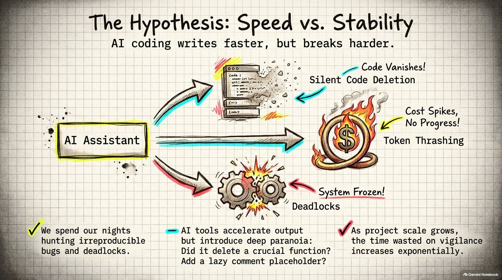
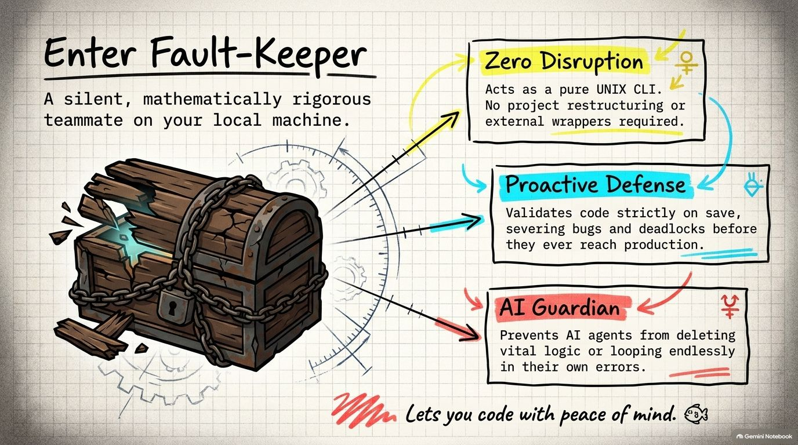
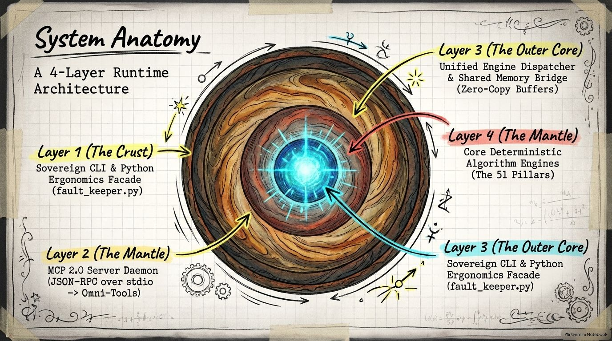
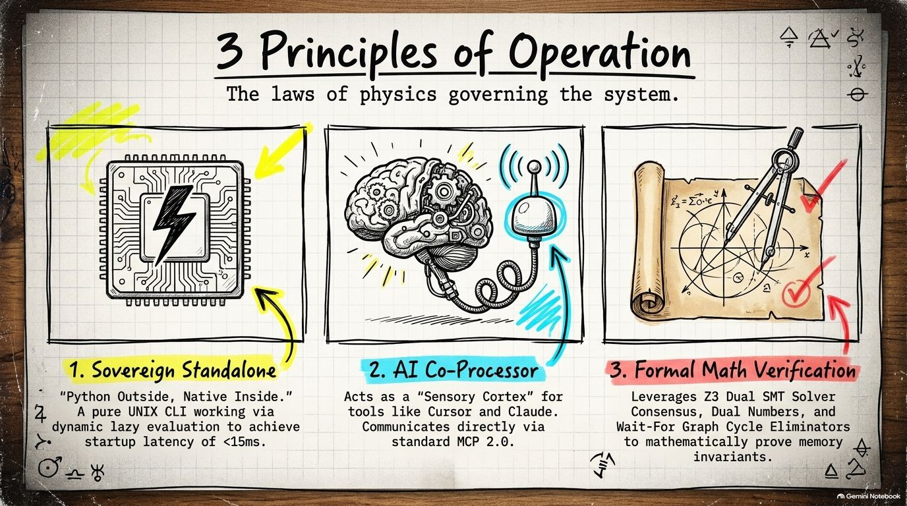
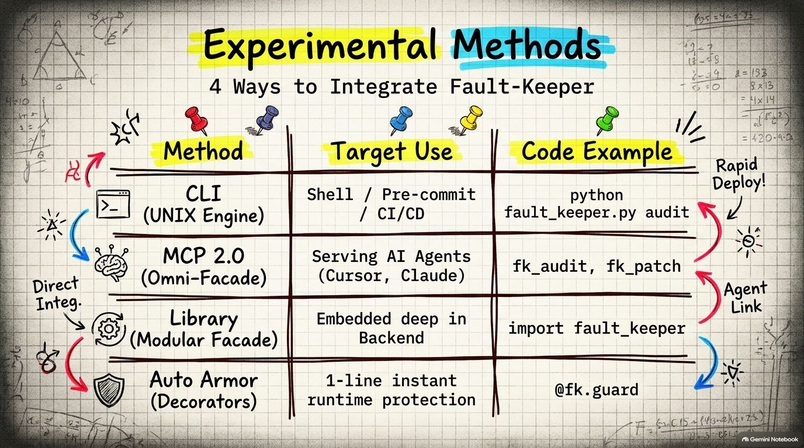
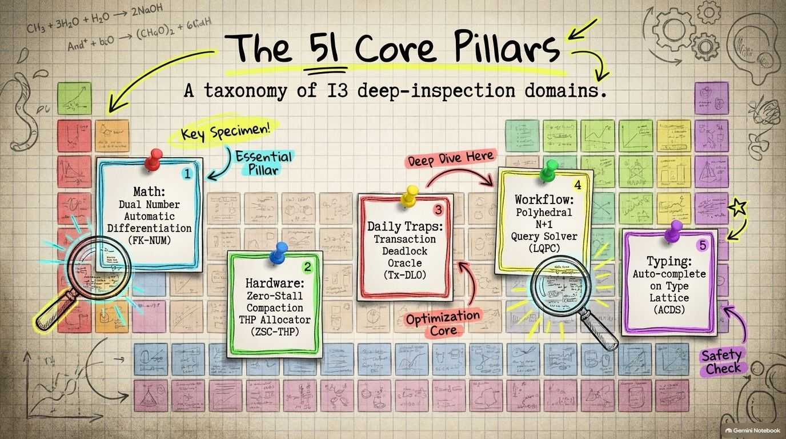
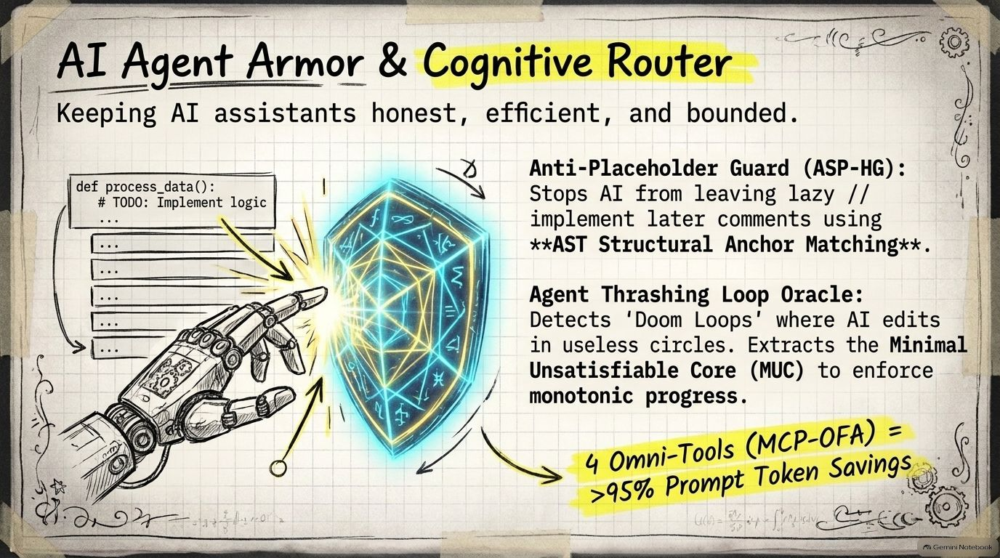
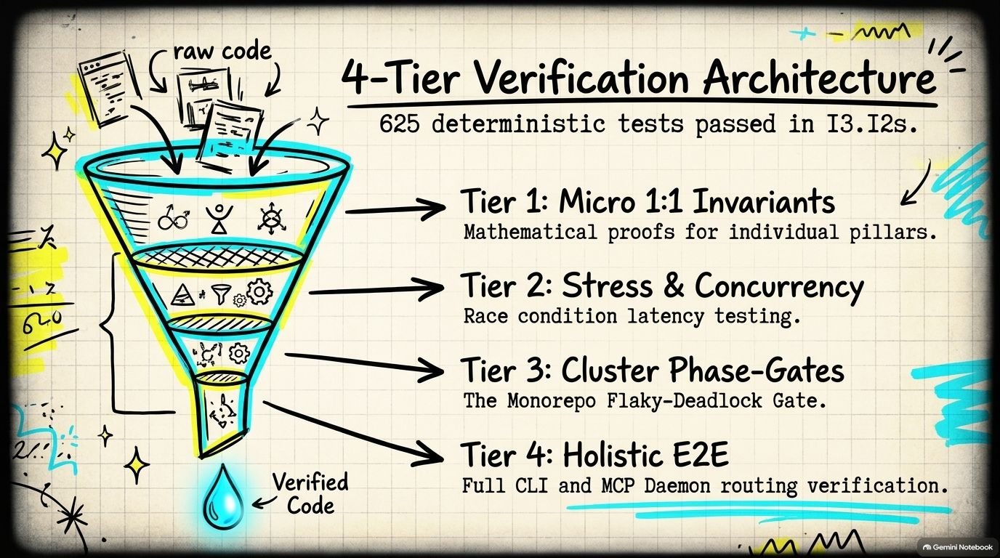

<div align="center">
  

  <br/><br/>

  <p align="center">
    <a href="./README.md"><b>🇬🇧 English</b></a> &nbsp;•&nbsp;
    <a href="./README_TH.md"><b>🇹🇭 ภาษาไทย</b></a> &nbsp;•&nbsp;
    <a href="./README_ZH.md"><b>🇨🇳 简体中文</b></a>
  </p>

  <h1 style="margin-bottom: 6px; font-size: 2.5em; letter-spacing: -0.5px; font-weight: 800;">Fault-Keeper</h1>
  <p style="font-size: 1.2em; font-weight: 500; color: #57606a; margin-top: 0; margin-bottom: 18px;">
    ソブリン級 AI コプロセッサ＆ゼロストール・システムセントリー
  </p>

  <p align="center">
    <a href="#"></a>
    <a href="#"></a>
    <a href="#"></a>
    <a href="#"></a>
    <a href="#"></a>
    <a href="#"></a>
    <a href="#"></a>
    <a href="https://ko-fi.com/xtanthaix" target="_blank"></a>
  </p>

  <p align="center">
    <b>51のコア工学ピラー · 13の深層検査ドメイン · 完全独立スタンドアロン構造 · 外部ラッパー不要</b>
  </p>
</div>

<br/>

<div align="left" style="line-height: 2.0; font-size: 1.05em; max-width: 860px; margin: 0 auto; color: #24292f;">

&nbsp;&nbsp;&nbsp;&nbsp;&nbsp;&nbsp;&nbsp;&nbsp;開発者の皆さん、こんにちは！🙏✨ 私たちが Fault-Keeper を開発したきっかけは、日々の開発現場で誰もが一度は頭を抱えたことのある共通の課題にありました。再現の難しい奇妙なハイゼンバグ（Heisenbugs）、実運用でアクセスが重なった瞬間に発生するデッドロック、あるいは低レイヤーのデータ構造をほんの少し変更しただけで静かに破綻してしまうシステムの脆さです。

&nbsp;&nbsp;&nbsp;&nbsp;&nbsp;&nbsp;&nbsp;&nbsp;AI コーディングアシスタントを活用することで開発速度は飛躍的に向上したものの、同時に新たな「疑心暗鬼」が生まれました。「重要なビジネスロジックが勝手に削除されていないか？」「手抜きの `// implement later` コメントで放置されていないか？」「トークンを無駄に浪費する堂々巡りの修正ループ（Doom Loop）に陥っていないか？」と常に警戒を強いられます。プロジェクトが大規模化するにつれ、AI の出力をチェックする労力の方が、本来の設計や実装にかける時間よりも大きくなっていました。

&nbsp;&nbsp;&nbsp;&nbsp;&nbsp;&nbsp;&nbsp;&nbsp;Fault-Keeper は、既存のコードやワークフローを変更することなく、お使いのマシン上でそのまま動作します。ファイルを保存した瞬間に数学的不変条件を検証し、本番投入前に潜む脆弱性を捕捉するとともに、AI がコードを勝手に削ったりループに陥るのを防ぐ安全装置として機能します。💖🐡

</div>

<br/>

| ⚠️ 仮説と課題：開発速度 vs システムの安定性 | 🌿 Fault-Keeper の導入 |
| :---: | :---: |
|  |  |
| *AI 協調プログラミングの危機：静かなコード欠落、全系デッドロック、無限ループによるトークンの浪費* | *ローカルで頼れる開発パートナー：リアルタイムな欠陥遮断、純粋なスタンドアロン実行、AI の逸脱制御* |

<br/>

---

<br/>

## 🌟 アーキテクチャの特徴と基本設計 (Architectural Highlights)

| 📐 4層ランタイム解剖図 (System Anatomy) | 🛡️ 3つの運用・設計原則 (Principles of Operation) |
| :---: | :---: |
|  |  |
| *4層ランタイムアーキテクチャ: ソブリン CLI (地殻) ➔ MCP 2.0 (マントル) ➔ 共有メモリブリッジ (外核) ➔ 51のコアピラー (内核)* | *3原則: ソブリン・スタンドアロン (独立実行)、AI コプロセッサ (感覚中枢)、形式的数学検証 (Z3 SMT)* |

<br/>

<details>
<summary><b>📐 4層ランタイムアーキテクチャ概要 (4-Layer Runtime Architecture)</b></summary>
<br/>

```text
┌──────────────────────────────────────────────────────────────────────────────────────┐
│                   FAULT-KEEPER v1.0 4層ランタイムシステムアーキテクチャ              │
├──────────────────────────────────────────────────────────────────────────────────────┤
│ 第1層: ソブリン CLI & Python エルゴノミクスファサード (fault_keeper.py, デコレータ, 遅延評価)│
├──────────────────────────────────────────────────────────────────────────────────────┤
│ 第2層: MCP 2.0 サーバーデーモン (JSON-RPC over stdio -> 5大オムニツール MCP-OFA)     │
├──────────────────────────────────────────────────────────────────────────────────────┤
│ 第3層: 統合ディスパッチャ & 共有メモリブリッジ (ゼロコピーメモリバッファプール)      │
├──────────────────────────────────────────────────────────────────────────────────────┤
│ 第4層: 決定論的コアアルゴリズムエンジン (51ピラー: 応用数学, 低レイヤー, SMT, AST)    │
└──────────────────────────────────────────────────────────────────────────────────────┘
```

</details>

<details>
<summary><b>🛡️ 3つのコア設計原則 (Core Principles)</b></summary>
<br/>

1. **ソブリン・スタンドアロン ("Python の外観、ネイティブの性能")**: 
   - 外部ラッパーに依存することなく、[`fault_keeper.py`](./fault_keeper.py) を介して純粋な UNIX CLI として即座に実行可能です。
   - 動的遅延評価（Lazy Evaluation）を採用し、起動時のオーバーヘッドを最小限に抑えています。
2. **AI コプロセッサ＆感覚中枢 (Sensory Cortex)**:
   - Cursor、Claude Code、Windsurf、Copilot、Antigravity などの AI コーディングツールの感覚中枢として機能します。
   - 標準の **MCP 2.0 プロトコル** に準拠し、ツールを **5つのオムニツール (Omni-Tools)** に集約することで、対話時のシステムプロンプトのトークン消費を大幅に削減します。
3. **形式的数学検証 (Formal Mathematical Verification)**:
   - **Z3 Dual SMT ソルバーコンセンサス**、**二重数自動微分 (Automatic Differentiation)**、**待ちグラフ（Wait-For Graph）閉路除去** により、論理的不変条件を厳密に証明します。
   - すべての検査はインメモリで数学的不変条件を直接検証するため、擬陽性や誤検知が発生しません。

</details>

---

<br/>

## 🛠️ インストール手順 (Installation)

<details>
<summary><b>📥 リポジトリのクローンと依存関係のセットアップ</b></summary>
<br/>

### 1. リポジトリをクローンして移動
```bash
git clone https://github.com/xTanTHaix/Fault-Keeper.git
cd Fault-Keeper
```

### 2. 依存パッケージのインストール
Fault-Keeper は Python 3.10、3.11、3.12 をサポートしています：

```bash
# 本番ランタイムの依存関係 (NumPy, SciPy, Z3 SMT ソルバー)
pip install -r requirements.txt

# テストスイート実行用 (PyTest)
pip install -r requirements-dev.txt
```

> **注記:** 基本的なコマンドライン操作（`audit`, `test-audit`）にはフォールバック機構が備わっているため、Z3 や SciPy などの拡張ライブラリが未インストールの場合でも即座に動作します。

</details>

---

<br/>

## 🚀 4つの利用形態 (The 4 Operational Postures)

Fault-Keeper はターミナル操作から AI エージェントの自律連携まで、柔軟なワークフローに対応します：

<div align="center">
  
  <p><i>4つの連携形態: CLI エンジン、AI 向け MCP 2.0、Python ライブラリ、および1行デコレータ</i></p>
</div>

<br/>

```text
┌────────────────────────────────────────────────────────────────────────────────────────┐
│                        FAULT-KEEPER v1.0 利用形態マトリクス                            │
├─────────────────────┬─────────────────────┬─────────────────────┬──────────────────────┤
│  形態 1: CLI        │ 形態 2: MCP 2.0     │ 形態 3: ライブラリ  │ 形態 4: デコレータ   │
│  (UNIX エンジン)    │ (オムニファサード)  │ (モジュラー統合)    │ (1行防御シールド)    │
├─────────────────────┼─────────────────────┼─────────────────────┼──────────────────────┤
│ python              │ fk_audit            │ import fault_keeper │ @fk.guard            │
│   fault_keeper.py   │ fk_diagnose         │ fk = FaultKeeper()  │ @fault_keeper.armored│
│   audit / test / diag│ fk_patch / fk_verify│ fk.systems.ZSC_ThP()│ (max_drift=0.05)     │
├─────────────────────┼─────────────────────┼─────────────────────┼──────────────────────┤
│ ターミナル / CI/CD  │ AI エージェント連携 │ バックエンド組込み  │ 重要関数を即時保護   │
│ プレコミットフック  │ (トークンを大幅削減)│ 深層アルゴリズム呼出│ デッドロックを1行遮断│
└─────────────────────┴─────────────────────┴─────────────────────┴──────────────────────┘
```

<br/>

<details>
<summary><b>💻 形態 1: コマンドラインインターフェース (fault_keeper.py)</b></summary>

<br/>

シェルから直接コードの監査、アーキテクチャ検査、システム診断を実行する6つのサブコマンド：

#### 1. ヘルプとオプション確認 (`--help`)
すべてのサブコマンドと利用可能なオプションを表示します：
```bash
python fault_keeper.py --help
```

#### 2. アーキテクチャ監査とデッドロック検出 (`audit`)
対象ディレクトリをスキャンし、未捕捉の静的障害（U-FSR）、凝集度・結合度指標（WPA-HIS）、DB トランザクションデッドロック閉路（Tx-DLO）、およびフロント・バックエンド間の破壊的 API 変更（CDC-ABS）を検出します：
```bash
python fault_keeper.py audit ./src
```
* **標準 POSIX 終了ステータス (Exit Codes):**
  * `0` = 正常完了（問題やデッドロックは検出されませんでした）
  * `1` = 違反検出（不変条件の破綻、デッドロックの危険性、または API 契約違反）
  * `2` = パスが存在しないか、引数の指定が不正です

#### 3. 不安定なテストの分離と毒性ペア検出 (`test-audit`)
順序置換スケジュール（Permutation Shuffling Sieve）を実行し、共有状態の汚染によって失敗するテストペア（汚染元と被害者のペア）を特定し、メモリリークを捕捉します：
```bash
python fault_keeper.py test-audit ./tests
```

#### 4. 深層根本原因診断 (`diagnose`)
ループ内の N+1 クエリ（LQPC）、非同期処理における `await` 漏れ競合（AE-FPS）、正規表現の ReDoS 破滅的バックトラック（RDA-NP）、週基準年フォーマット（TC-GTC）、レスポンシブ崩れ（GSLD）を診断します：
```bash
# 全体診断
python fault_keeper.py diagnose ./src

# Strict モード（欠陥検出時に終了コード 1 を返却、CI/CD ゲートに最適）
python fault_keeper.py diagnose ./src --strict
```

#### 5. AST ベースのスマート 3-Way マージ (`solve-merge`)
Git のマージコンフリクトを抽象構文木レベルで解決し、可換な文の順序を自動調停して構文ツリーをマージします（ファイルパスおよびインラインコードに対応）：
```bash
python fault_keeper.py solve-merge base.py our_changes.py their_changes.py
```

#### 6. MCP JSON-RPC 2.0 サーバー起動 (`mcp`)
Cursor、Claude Desktop、Antigravity などの AI クライアントから接続可能な MCP stdio デーモンを起動します：
```bash
python fault_keeper.py mcp
# トランスポートを明示的に指定する場合:
python fault_keeper.py mcp --transport stdio
```

</details>

<br/>

<details>
<summary><b>🤖 形態 2: MCP 2.0 を介した AI エージェント連携 (Cursor, Claude, Antigravity)</b></summary>

<br/>

Fault-Keeper には、**MCP 2.0 仕様** に完全準拠したスタンドアロンサーバーが同梱されています：

#### エントリポイント: [`mcp_server.py`](./mcp_server.py)
MCP 設定ファイル（例: `~/.gemini/config/mcp_config.json`、`claude_desktop_config.json`、または Cursor の設定）に以下を追加します：

```json
{
  "mcpServers": {
    "fault-keeper": {
      "command": "python",
      "args": [
        "L:\\.Tool\\Fault-Keeper\\mcp_server.py"
      ],
      "env": {
        "PYTHONUNBUFFERED": "1",
        "PYTHONIOENCODING": "utf-8"
      }
    }
  }
}
```

#### AI 向け 5大オムニツール (Omni-Tools):
1. **`fk_audit`**: ファイルまたはディレクトリを走査し、安全性・構造・デッドロックを監査します。
2. **`fk_diagnose`**: ボトルネック、非同期競合、N+1 クエリ、ReDoS、因果的根本原因を診断します。
3. **`fk_patch`**: 規範的な修正パッチを生成し、隔離されたシャドウサンドボックス内で事前検証します。
4. **`fk_verify`**: システム間の契約を照合し、数学的要件を形式的に証明します。
5. **`fk_discover`**: AI エージェントが 51 のピラー仕様をオンデマンド（JIT）で検索・参照できるようにします。

#### チャットプロンプトの例:
MCP の接続後、ターミナルを開くことなくチャット上で指示するだけで動作します：
* *「src フォルダ配下のコードを監査して」* ➔ エージェントが `fk_audit` を実行
* *「このモジュールの根本的なバグ原因を突き止めて」* ➔ エージェントが `fk_diagnose` を実行
* *「この修正パッチをサンドボックスで安全にテストして」* ➔ エージェントが `fk_patch` を実行
* *「フロントとバックエンドの API 整合性を検証して」* ➔ エージェントが `fk_verify` を実行
* *「DB のトランザクションデッドロックを防ぐピラーを教えて」* ➔ エージェントが `fk_discover` を実行

</details>

<br/>

<details>
<summary><b>📦 形態 3: Python ライブラリ＆統合ファサード (FaultKeeper)</b></summary>

<br/>

単一のファサードクラスを通じて、遅延評価による省メモリ設計の全 51 エンジンへアクセス可能です：

```python
import fault_keeper

# シングルトンファサードを初期化
fk = fault_keeper.FaultKeeper()

# 1. 高精度数値演算および自動微分 (Automatic Differentiation)
dual_x = fk.num.DualNumber(real=3.0, dual=1.0)
y = dual_x * dual_x + 5.0  # y = x^2 + 5
print(f"関数値: {y.real}, 微分値: {y.dual}")

# 2. タイムゾーン YYYY 年表記トラップの検出
has_trap, details = fk.num.TimezoneDriftDetector.detect_format_drift("YYYY-MM-dd")
if has_trap:
    print(f"警告: 週基準年の指定により年末年始の日付がずれる可能性があります: {details}")

# 3. トランザクションデッドロック閉路の検知
wfg = fk.daily.WaitForGraph()
wfg.add_dependency(tx_a="TX1", tx_b="TX2")
wfg.add_dependency(tx_a="TX2", tx_b="TX1") # 閉路の形成
cycles = wfg.detect_cycles()
print(f"検出されたデッドロック閉路: {cycles}")

# 4. ハードウェア認識型ゼロストールメモリアロケータ
allocator = fk.systems.ZSC_ThP() # デュアルプール・ゼロコンパクションストール THP アロケータ
ptr = allocator.allocate(size_bytes=1024 * 1024 * 2) # 2MB THP 静的アリーナから割り当て
```

</details>

<br/>

<details>
<summary><b>🛡️ 形態 4: 1行デコレータによる即時保護 (@armored, @guard)</b></summary>

<br/>

重要なビジネスロジックにシンプルなデコレータを付与するだけで、実行時不変条件を保護します：

```python
import fault_keeper

# 状態ドリフトの監視と数学的許容誤差の強制
@fault_keeper.armored(max_drift=0.05)
def critical_financial_settlement(account_id: str, balance: float):
    # 状態の偏りが閾値を超えた場合、即座に例外を送出または警告
    return process_settlement(account_id, balance)

# 防御的入力アサーションの保護
@fault_keeper.guard
def transfer_funds(source: str, target: str, amount: float):
    assert amount > 0, "振込金額はゼロより大きい必要があります"
    return execute_transfer(source, target, amount)
```

</details>

---

<br/>

## 🏛️ 51のコア工学ピラー一覧 (The 51 Core Pillars Catalog)

システムは **13の主要ドメイン** で構成されており、応用数学からカーネル、AI 防御までを網羅しています：

| 🧪 51ピラー周期表 (Taxonomy) | 🛡️ AI エージェントアーマー＆認知ルーター (AI Agent Armor) |
| :---: | :---: |
|  |  |
| *51のピラーが13ドメインをカバー: 高度な数値計算からハードウェアメモリ管理、日常の開発バグまで* | *AI の手抜きプレースホルダー遮断 (ASP-HG)、無限ループ破壊 (ACT-LO)、オムニツールによるトークン削減* |

<br/>

<details>
<summary><b>1. 応用数学＆数値計算カーネル (fk.num): 3ピラー</b></summary>
<br/>

| ピラー記号 | 正式名称 | 仕組みと役割 |
| :--- | :--- | :--- |
| **FK-NUM** | Numerical Kernel | 二重数自動微分、金融グレードの 128-bit 固定小数点演算、および $O(1)$ Welford ストリーミング分散計算。 |
| **FK-SLA** | Sparse Linear Algebra | 64 バイトキャッシュライン整列 SIMD CSR/CSC 構造、並列 SpMV、ピボット付きコレスキー分解、ランダム化低ランク SVD。 |
| **FK-GEO** | Robust Geometry Engine | Shewchuk 適応精度浮動小数点述語（Orient2D / InCircle）、30-bit Morton 符号リニア BVH ツリー、および $O(N \log N)$ 単調連鎖凸包による幾何計算の破綻防止。 |

</details>

<details>
<summary><b>2. ハードウェア・マイクロアーキテクチャ・低レイヤー (fk.systems): 16ピラー</b></summary>
<br/>

| ピラー記号 | 正式名称 | 仕組みと役割 |
| :--- | :--- | :--- |
| **NUMA-AFS** | NUMA-Aware Affinity Sentry | ACPI SLIT 距離行列を解析し、局所性商（LQ）を算出。Kuhn-Munkres 2部グラフマッチング（KM-BAW）でコアとメモリページを束縛し、インターコネクトの停滞を解消。 |
| **ZSC-THP** | Zero-Stall Compaction THP | 2MB THP 静的アリーナと 4KB 動的プールを分離したハイブリッドデュアルプール（DHACS）と非同期バックグラウンド吸引により、直接コンパクション停止時間 0.0ms を実現。 |
| **FS-CCO** | False Sharing Cache Optimizer | 構造体レイアウトを 64 バイトキャッシュライン境界に整列させ、ワーカースレッド並列時の L1 キャッシュ無効化スラッシングを防止。 |
| **HEH-DR** | Hazard-Epoch Hybrid Reclamation | 3世代エポックベース回収（EBR）とハザードポインタを融合させたロックフリーメモリ回収機構。回収オーバーヘッド $< 3\%$。 |
| **APM-RLME** | Adaptive Array Layout Engine | 実行時の読み書き比率に応じて、ベクトル化 SIMD ストライドを用いて構造体配列（AoS）と配列の構造体（SoA）間をゼロストールで相互変換。 |
| **TSCA** | Topological Simplicial Arbiter | 単体的複体（Simplicial Complex）トポロジーに基づくウェイトフリー並行処理調停機構。第1ベッチ数（$H_1 = 0$）によってデッドロック閉路の不在を数学的に証明。 |
| **CAM-RO** | Cross-Arch Memory Reordering | リトマステストを解析し、x86 TSO と ARMv8/RISC-V 弱メモリモデル間で安全なアトミックメモリバリアを自動合成。 |
| **AC-SBE** | Auto-Cooperative Yield Injector | 非同期ループ内の重い CPU 処理を AST 解析で検出し、自動で協調的プリエンプション（Yield）を挿入してイベントループのスタベーションを防止。 |
| **EV-IPP** | eBPF Verifier Simulator | IDE 内で 64-bit 切り捨て数（Tnum）およびレジスタ境界をシミュレートし、eBPF プログラムの終了性とメモリ安全性を形式検証。 |
| **SABA** | SIMD Auto-Vectorization Analyzer | ループ間依存距離とポインタエイリアスを解析し、コンパイラの自動ベクトル化（AVX-512 / NEON）を阻害する要因を排除。 |
| **SC-BBW** | Spectral Basic-Block Weaver | 制御フローグラフのグラフ・ラプラシアンを構築し、フィードラーベクトルを用いて基本ブロックを最適配置。命令キャッシュミスを削減。 |
| **PT-PAFS** | Pointer Provenance & Tree Borrows | Tree Borrows モデルに基づきポインタの出自と借用状態を追跡。Unsafe C/Rust における未定義動作や厳格エイリアス違反を検知。 |
| **DIS-RA** | Deterministic io_uring Arbiter | ゼロコピーによる io_uring 送信キュー（SQ）・完了キュー（CQ）管理と確定論的バックプレッシャーにより、CQE オーバーフローを未然に防止。 |
| **H-TSS** | Hardware Tagged Pointer Sentry | ARM TBI および x86 UAM のタグ付きポインタを模擬し、実行時における解放後使用（UAF）やバッファオーバーフローを検知。 |
| **MD-BBE** | Monomorphization Deduplicator | ジェネリクス展開間の構造的 ABI ハッシュを照合し、完全に等価な実装を共通ポリモーフィック Thunk に統合。バイナリサイズを 40%〜70% 削減。 |
| **DMCS** | Dominator-Tree Memory Cut Sentry | 支配木（Dominator Tree）を用いて参照グラフを解析し、最大流最小カット法で循環参照クラスタを切断。リークしたメモリの $\ge 80\%$ を安全に回収。 |

</details>

<details>
<summary><b>3. 日常の開発バグ＆ピットフォール (fk.daily): 7ピラー</b></summary>
<br/>

| ピラー記号 | 正式名称 | 仕組みと役割 |
| :--- | :--- | :--- |
| **FT-DSO** | Flaky Test Sieve & Order Oracle | 順序置換スケジュール（$\pi_{\text{shuf}}$）、グレイコード 2分探索毒性ペア検出（$O(N \log N)$）、状態リーク検知、仮想イベントクロック消滅機構。 |
| **Tx-DLO** | Transaction Deadlock Oracle | 待ちグラフ（$\mathcal{G}_{\text{wfg}}$）解析により Havender 順序（$\prec_{\text{lock}}$）を強制。バッチキーの事前整列により $\Pr(\text{Deadlock}) \equiv 0.0$ を担保。 |
| **CDC-ABS** | Cross-Boundary Contract Sentry | フロント・バックエンド間の破壊的 API 変更を AST レベルで検出（Zero-E2E）。構造的部分型共変不変条件でクライアント破損を防止。 |
| **AEC-VS** | Env Contract & Secret Sentry | 環境変数設定（`.env`）を形式検証し、機密情報の流出阻止と型安全性を徹底。 |
| **TC-GTC** | Timezone & DST Trap Detector | タイムゾーンのずれ、夏時間（DST）の誤算、および週基準年 `YYYY` と暦年 `yyyy` の取り違えトラップを捕捉。 |
| **RDA-NP** | ReDoS Catastrophic Backtrack Sentry | 正規表現の計算量を解析し、指数関数的・多項式的な破滅的バックトラッキングの脆弱性をデプロイ前に遮断。 |
| **CASI-OP** | Cache Stampede & Invalidation Sentry | キャッシュ無効化と DB トランザクションを同期調整し、XFetch 確率的早期再計算によりキャッシュスタンピードを完全防止。 |

</details>

<details>
<summary><b>4. AI エージェントアーマー＆認知ルーター (fk.armor, fk.mcp): 4ピラー</b></summary>
<br/>

| ピラー記号 | 正式名称 | 仕組みと役割 |
| :--- | :--- | :--- |
| **ASP-HG** | Anti-Placeholder Guard | AST 構文構造アンカー照合により、AI による手抜きコード省略（`// implement later`, `... existing code ...` 等）を検知して遮断。 |
| **ACT-LO** | Agent Thrashing Loop Oracle | コード修正の堂々巡り（Doom Loop）を検出し、単調進捗不変条件を強制するとともに、最小充足不能核（MUC）を特定。 |
| **SC-PVE** | Speculative Candidate Parallel Verifier | インメモリ Copy-on-Write シャドウサンドボックス上で複数パッチ候補を並列推論・検証し、Zhang-Shasha 編集距離で最良パッチを選定。 |
| **MCP-OFA** | Model Context Protocol Omni-Facade | 51 の機能を 5 つのオムニツールに集約してシステムプロンプトのトークン消費を抑え、JIT 漸進的探索（`fk_discover`）を支援。 |

</details>

<details>
<summary><b>5. ワークフロー・型システム・形式検証・分散システム: 21ピラー</b></summary>
<br/>

| カテゴリ | 代表的ピラー | 仕組みと役割 |
| :--- | :--- | :--- |
| **型システム (fk.typing)** | **FSAS**, **ATH-BS**, **AE-FPS**, **TWSA**, **ACDS** | 仮想 Ghost CST 構文修復、型穴 DTO 合成、コルーチンの `await` 漏れ競合検出、型束オートコンプリート。 |
| **ワークフロー (fk.workflow)** | **CRCAE**, **LQPC**, **SSDL**, **STAS**, **A-SMW**, **PTHO** | 1行根本原因因果帰納、多面体モデルによる N+1 クエリ解消、依存関係地獄の解決、AST 3-Way マージ。 |
| **コード監査 (fk.audit)** | **U-FSR**, **WPA-HIS** | 単一ファイルの堅牢性評価（シャノンエントロピー、凝集度）およびプロジェクト全体の設計品質スコアリング（0〜100点）。 |
| **フルスタック (fk.workflow)** | **ZEC-SW**, **GSLD** | シャドウトリガーによるゼロダウンタイム DB マイグレーション、線形計画法シンプレックスによるレスポンシブ CSS クリッピング解消。 |
| **形式手法 (fk.formal)** | **CIS3**, **DCEG**, **SADS**, **FSLS** | 双対 Z3 SMT コンセンサスによるモックデータ生成、微分因果グラフ、圏論によるコード代数同期。 |
| **分散・タイムトラベル (fk.dist)** | **D-CAS**, **CADRE** | ネットワーク分断およびクロックドリフトの決定論的再現、および全知型タイムトラベル実行トレーサー。 |

</details>

---

<br/>

## 🧪 テスト検証アーキテクチャと品質ゲート (Test Verification & Quality Gates)

<div align="center">
  
  <p><i>4段階の厳格な検証体系: ミクロな 1:1 不変条件から高負荷並行、クラスタゲート、統合 E2E まで 100% 健全なコードを保証</i></p>
</div>

<br/>

<details>
<summary><b>🛡️ 4段階の検証階層構造</b></summary>
<br/>

Fault-Keeper は 4 つの厳格な検証レイヤーで品質を担保しています：
1. **Tier 1 (ミクロ 1:1 不変条件)**: 51 の各ピラーにおける数学的方程式と不変条件を実コードで検証。
2. **Tier 2 (ストレステスト＆並行性)**: ナノ秒単位の遅延制約と高並行競合状態の耐久テスト。
3. **Tier 3 (クラスタ・フェーズゲート)**: 大規模モノレポの Flaky・デッドロック検証やマルチソケット NUMA クラスタなど、実世界の複合環境を完全シミュレート。
4. **Tier 4 (統合 E2E)**: POSIX 準拠の CLI サブコマンドおよび MCP デーモンの JSON-RPC 双方向通信テスト。

```bash
# 全 723 テストを実行
python -m pytest -q
```
```text
============================ 723 passed in 73.14s =============================
```

</details>

---

<br/>

## 📁 リポジトリ構造 (Repository Directory Layout)

<details>
<summary><b>📂 完全なディレクトリツリー</b></summary>
<br/>

```text
Fault-Keeper/
├── fault_keeper.py            # ソブリン独立 CLI エントリポイント (第1層)
├── mcp_server.py              # MCP 2.0 JSON-RPC サーバーデーモン (第2層)
├── pyproject.toml             # パッケージ構成とプロジェクトメタデータ
├── requirements.txt           # 本番ランタイム依存関係 (NumPy, SciPy, Z3)
├── requirements-dev.txt       # 開発およびテスト用依存関係 (PyTest)
│
├── src/
│   └── fault_keeper/          # コアファサードおよび内部モジュール
│       ├── __init__.py        # シングルトン FaultKeeper & 動的遅延ローダー
│       ├── facade.py          # 統合オムニファサードおよびサブシステムルーター
│       ├── systems/           # ハードウェア＆システム低レイヤーセントリー (16ピラー: NUMA, THP, eBPF...)
│       ├── daily/             # 日常のトラップ回避 (FT-DSO, Tx-DLO, CDC-ABS)
│       ├── typing/            # 内部ループ型安全セントリー (Ghost CST, Await 検知)
│       ├── workflow/          # 開発者生産性向上 (CRCAE, SSDL, N+1 クエリ解消)
│       ├── audit/             # アーキテクチャ健全性監査 (U-FSR, WPA-HIS)
│       └── ...                # その他コアエンジン群 (num, sla, geo, armor, formal, dist)
│
├── tests/                     # 4段階のゼロモック確定論的テストスイート (723テスト)
│   ├── test_tier1_invariants.py
│   ├── test_exhaustive_imports.py
│   ├── test_phase2_tier3_cluster_gate.py
│   ├── test_phase3_tier3_cluster_gate.py
│   └── pillars/               # 各ピラーごとの 1:1 不変条件テスト
│
└── assets/
    ├── fault_keeper_chest.png # 公式ビジュアルマスコット
    └── 1.jpg - 9.jpg          # アーキテクチャ図解およびインフォグラフィック
```

</details>

## ☕ 開発時間の奪還とご支援について (Reclaim Your Time & Support)

<div align="center">
  
  <p><i>不安から解放され、純粋な創作へ：クローンし、インストールして、安心してコードを書く</i></p>
</div>

<br/>

Fault-Keeper があなたの開発時間とメンタルの平穏を守る一助となりましたら、今後の継続的なアップデートの励みとして、Ko-fi で温かいコーヒーや紅茶のご支援をいただけますと大変嬉しく思います：

<p align="left">
  <a href="https://ko-fi.com/xtanthaix" target="_blank">
    
  </a>
</p>

開発者の皆様の温かいご支援とフィードバックに心より感謝申し上げます！🙏💖☕

---

<br/>

## 📜 ライセンス (License)

本プロジェクトはオープンソースの **MIT License** のもとで公開されています。個人開発、改変、再配布、および商用プロジェクトへの組み込みも含め、自由にご利用いただけます。✨
